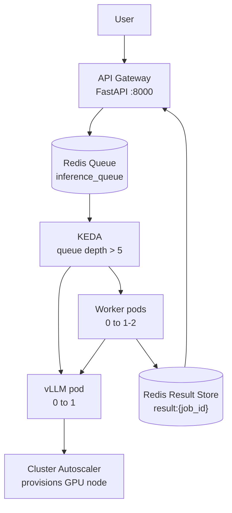

<div align="center">

# Scale-to-Zero GPU Inference with KEDA

[](https://www.python.org/downloads/)
[](https://kubernetes.io/)
[](LICENSE)

**Cost-optimized LLM inference platform: FastAPI gateway, Redis queue, vLLM workers on GPU nodes,
KEDA event-driven pod autoscaling, and Cluster Autoscaler node provisioning — scale to zero and pay
nothing when idle.**

[Architecture](#architecture) | [Getting Started](#getting-started) | [How It Works](#how-it-works) | [Results](#results) | [Demo](#demo)

</div>

---

## What you build

A cost-optimized inference system:

1. Requests arrive at a **FastAPI gateway** and are enqueued in **Redis**.
2. **vLLM workers** on GPU nodes pull jobs from the queue via `BRPOP` and serve inference
   (OpenAI-compatible `/v1/completions`) with continuous batching.
3. **KEDA** watches the Redis queue length and scales the worker and vLLM Deployments between
   **0 and N replicas**.
4. The pending vLLM pod requests `nvidia.com/gpu: 1`, which triggers the **Cluster Autoscaler** to
   provision a GPU node. When the queue is empty, KEDA scales pods to zero and the GPU node is
   deprovisioned — **idle cost is $0/hr at both layers**.
5. **Grafana** (12 panels) visualizes queue depth, GPU utilization/power/memory, TTFT, throughput,
   pod replicas, and node count.

Cold-start optimizations cut end-to-end scale-up from ~11 min to ~5.6 min by (1) moving model
weights to a PersistentVolumeClaim and (2) pre-caching container image layers on a GKE Secondary
Boot Disk.

---

## Table of Contents

- [Features](#features)
- [Tech Stack](#tech-stack)
- [Architecture](#architecture)
- [Getting Started](#getting-started)
  - [Prerequisites](#prerequisites)
  - [Local GPU (k3d)](#local-gpu-k3d)
  - [Cloud GPU (GCP GKE)](#cloud-gpu-gke)
  - [Configuration](#configuration)
- [Usage](#usage)
- [How It Works](#how-it-works)
- [API Reference](#api-reference)
- [Observability](#observability)
- [Methodology: Cold-Start Optimization](#methodology-cold-start-optimization)
- [Results](#results)
- [Demo](#demo)
- [Project Structure](#project-structure)
- [Deployment Scripts](#deployment-scripts)
- [License](#license)

---

## Features

- **Scale-to-zero GPU nodes** — Cluster Autoscaler provisions and deprovisions GPU VMs based on
  pending pod scheduling; $0/hr when idle.
- **Event-driven pod autoscaling** — KEDA ScaledObjects watch Redis queue depth, scaling worker
  and vLLM Deployments between 0 and N replicas.
- **Queue-buffered inference** — Redis absorbs request bursts during cold start; no dropped
  traffic, no client-side retry needed.
- **Continuous batching** — vLLM batches concurrent requests at the attention layer, maximizing
  GPU throughput per dollar.
- **Cold-start optimization** — model weights on PVC (survives pod churn) plus container image
  layer caching via GKE Secondary Boot Disk (~11 min → ~5.6 min).
- **GPU telemetry** — NVIDIA DCGM exporter (utilization, power, VRAM), vLLM Prometheus exporter
  (KV cache, TTFT, tokens/sec), kube-state-metrics (pod/node lifecycle).
- **12-panel Grafana dashboard** — queue depth, GPU util, TTFT, tokens/sec, node count.

---

## Tech Stack

| Layer | Tool | Role |
|---|---|---|
| API Gateway | FastAPI | Async request ingestion, job ID issuance |
| Message Queue | Redis (+ redis-exporter) | Job buffering, result store (5 min TTL) |
| Pod Autoscaler | KEDA ScaledObject | Event-driven 0→N scaling on queue depth |
| Node Autoscaler | GKE Cluster Autoscaler | GPU VM provisioning on pending pod |
| Inference Engine | vLLM (OpenAI-compatible) | Continuous batching, KV cache, Prometheus metrics |
| Model | Qwen/Qwen2.5-1.5B-Instruct | 3.5 GB VRAM, ~50 tok/s aggregate on T4 |
| GPU Telemetry | NVIDIA DCGM exporter | GPU utilization, power, memory via Prometheus |
| Cluster Metrics | kube-state-metrics | Pod replica counts, node capacity, deployment state |
| Dashboarding | Grafana (12 panels) | Queue depth, GPU util, TTFT, tokens/sec, node count |
| Load Testing | Locust | Concurrent prompt injection for scaling validation |

---

## Architecture



### Autoscaling Layers

| Layer | Mechanism | Trigger | Scales | Latency |
|---|---|---|---|---|
| Pod | KEDA ScaledObject → HPA | `redis_key_size{key="inference_queue"}` > 5 | Worker 0→2, vLLM 0→1 | ~30s (KEDA polling) |
| Node | GKE Cluster Autoscaler | Pending pod with `nvidia.com/gpu: 1` | GPU VM (n1-standard-4, T4) 0→1 | ~2 min (GCE boot) |
| Image | GKE Secondary Boot Disk | Node boot event | Container layer cache on local pd-ssd | ~7s (local load) |
| Model | PersistentVolumeClaim | vLLM pod start | Qwen2.5-1.5B weights at `/root/.cache/huggingface` | ~2.5 min (VRAM load) |

---

## Getting Started

### Prerequisites

- Python 3.12+
- Docker with NVIDIA GPU support (for local vLLM)
- k3d, kubectl, helm (local) — or `gcloud` CLI (cloud GKE)
- locust (load testing)

### Local GPU (k3d)

```bash
# 1. Start vLLM on the host (uses your local GPU directly)
docker run --gpus all -p 8000:8000 --ipc=host \
  vllm/vllm-openai:v0.19.0 --model Qwen/Qwen2.5-1.5B-Instruct \
  --max-model-len 4096 --gpu-memory-utilization 0.8 --enforce-eager

# 2. Create the k3d cluster, build/import images, install KEDA, apply manifests, deploy monitoring
./scripts/deploy-local.sh

# 3. Run the load test
pip install locust
locust -f loadtest/locustfile.py --host http://localhost:8080
```

> Note: k3d has no GPU passthrough, so locally vLLM runs on the host GPU and the worker is
> pointed at `http://host.docker.internal:8000`. The two-layer autoscaling story (KEDA pods +
> Cluster Autoscaler GPU nodes) is fully realized on cloud GKE below.

### Cloud GPU (GCP GKE)

```bash
# The deploy script reads the project id from the environment
export GCP_PROJECT=<your-gcp-project-id>

# Creates the GKE cluster, GPU node pool (n1-standard-4 + T4 Spot, 0-1 nodes),
# pushes images to Artifact Registry, applies all manifests
./scripts/deploy-gcp.sh

# Get the gateway IP
GATEWAY_IP=$(kubectl get svc gateway -n llm-gateway -o jsonpath='{.status.loadBalancer.ingress[0].ip}')
curl http://$GATEWAY_IP/health

# Trigger scaling (6+ requests to exceed the KEDA queue-depth threshold of 5)
for i in $(seq 1 6); do
  curl -s -X POST http://$GATEWAY_IP/generate \
    -H 'Content-Type: application/json' \
    -d '{"prompt":"Explain autoscaling"}' &
done

# Watch two-layer scaling
kubectl get nodes -w                    # GPU node appears (~2-4 min)
kubectl get pods -n llm-gateway -w      # vLLM + worker go Pending to Running

# Load test
locust -f loadtest/locustfile.py --host http://$GATEWAY_IP

# Monitoring
kubectl port-forward svc/grafana 3000:3000 -n llm-gateway

# ALWAYS tear down after session (~$0.10/hr control plane + ~$0.11/hr GPU Spot while running)
./scripts/destroy-gcp.sh
```

### Configuration

```bash
cp .env.example .env
```

| Variable | Default | Description |
|---|---|---|
| `VLLM_URL` | `http://vllm:8000` | In-cluster vLLM Service (overridden to host for local k3d) |
| `REDIS_HOST` | `redis` | Redis Service name |
| `REDIS_PORT` | `6379` | Redis port |
| `MODEL_ID` | `Qwen/Qwen2.5-1.5B-Instruct` | HuggingFace model served by vLLM |

---

## Usage

Submit a prompt and poll for the result. The gateway never blocks on inference; every prompt is
enqueued and returns a `job_id` immediately.

```bash
# Submit a prompt (returns a job_id immediately)
curl -X POST http://$GATEWAY_IP/generate \
  -H 'Content-Type: application/json' \
  -d '{"prompt":"Explain autoscaling"}'

# Poll for the result
curl http://$GATEWAY_IP/result/{job_id}
```

Response shapes:

- `POST /generate` → `{"status": "queued", "job_id": "<uuid>"}`
- `GET /result/{job_id}` → `{"status": "pending"}` until done, then
  `{"status": "done", "response": "..."}`
- `GET /health` → `{"status": "ok"}`

Results expire after 5 minutes (TTL 300s).

---

## How It Works

### 1. Request flow

Every prompt is enqueued immediately. `/generate` always returns a `job_id`. No request blocks
for inference — Redis absorbs bursts during cold start.

### 2. Autoscaling chain

1. Queue depth crosses **5** (KEDA ScaledObject trigger).
2. KEDA scales the **Worker Deployment** from 0→2 and the **vLLM Deployment** from 0→1.
3. The vLLM pod enters `Pending`: it requests `nvidia.com/gpu: 1` with a GPU taint toleration.
4. Cluster Autoscaler provisions an **n1-standard-4 + T4 Spot** node (~2 min).
5. The GPU node boots with the container image pre-cached (Secondary Boot Disk, ~7s).
6. vLLM loads model weights from the PVC into VRAM (3.5 GB, ~2.5 min).
7. The readiness probe (`httpGet /health`, `failureThreshold: 60`) passes.
8. Workers pull jobs via `BRPOP` and POST to vLLM `/v1/completions`.
9. Results are written to Redis (`result:{job_id}`, TTL 300s).
10. The queue drains, the KEDA cooldown (300s) elapses, and pods scale to **0**.
11. Cluster Autoscaler sees the node unneeded for 10 min and deletes the GPU VM — full zero state.

### 3. Result retrieval

Poll `GET /result/{job_id}`. Returns `{status: pending}` until inference completes, then
`{status: done, response: "..."}`. Results expire after 5 minutes.

---

## Observability

Four Prometheus exporters feed the 12-panel Grafana dashboard:

| Exporter | Endpoint | Key Metrics |
|---|---|---|
| redis-exporter | `:9121` | `redis_key_size{key="inference_queue"}` queue depth |
| DCGM exporter | `:9400` | `DCGM_FI_DEV_GPU_UTIL`, `DCGM_FI_DEV_POWER_USAGE`, `DCGM_FI_DEV_FB_USED` |
| vLLM (built-in) | `:8000` | `vllm:num_requests_running`, `vllm:kv_cache_usage_perc`, `vllm:generation_tokens_total`, `vllm:time_to_first_token_seconds_bucket` |
| kube-state-metrics | `:8080` | `kube_deployment_status_replicas`, `kube_node_status_capacity{resource="nvidia_com_gpu"}` |

Scrape interval: 15s. Retention: 24h.

`scripts/full-cycle-run.sh` executes a complete scale-to-zero → cold start → warm response →
scale-to-zero cycle and captures raw event logs from every layer (K8s events, KEDA scaling,
Redis queue, pod lifecycle, node lifecycle, container logs) under `data/`.

```bash
./scripts/full-cycle-run.sh [GATEWAY_IP]
```

`scripts/plot_run.py` renders a run directory's logs as a PNG figure:

```bash
pip install matplotlib
python scripts/plot_run.py data/run-<timestamp> docs/run-<timestamp>.png
```

---

## Methodology: Cold-Start Optimization

Full details in [`docs/cold-start-optimization.md`](docs/cold-start-optimization.md).

**Baseline (~11 min):** an 11 GB vLLM image baked with model weights. The 3.5 GB of weights
added ~1.5 min of network pull time to save a 29s HuggingFace download — the wrong tradeoff.
Containerd's 3-concurrent-layer pull cap and CPU decompression on a 4-vCPU node throttled pulls
to ~28 MB/s.

**Optimization 1 — PersistentVolume for model weights:** Reverted to the stock 8 GB
`vllm/vllm-openai` image. A one-time init Job downloads Qwen2.5-1.5B to a 10 Gi PVC; vLLM
mounts it at `/root/.cache/huggingface`. The PVC survives pod restarts and node deletion.

**Optimization 2 — GKE Secondary Boot Disk:** Built a GCE disk image with the 8 GB vLLM
container layers pre-extracted into containerd's image store (`scripts/build-node-cache.sh`).
GPU nodes boot with the disk attached at `mode=CONTAINER_IMAGE_CACHE`, so containerd finds the
image on local pd-ssd — no network pull (~7s vs ~5 min).

**Approaches that did not work:** GKE Image Streaming alone (lazy remote IO killed Python/CUDA
imports), eStargz/Stargz Snapshotter (blocked by managed containerd), DaemonSet pre-pull (cache
dies with the node on scale-to-zero), Artifact Registry tuning (no exposed knobs), min-1 always-on
GPU node (defeats the $0/hr FinOps story).

---

## Results

### Cold-start optimization

Hardware: GCP GKE, NVIDIA T4 Spot, n1-standard-4, us-east1-d.

| Phase | Baseline (11 GB baked) | After Opt 1 (PV only) | After Opt 1 + Opt 2 (PV + SBD) |
|---|---|---|---|
| GPU node provision | ~2.5 min | ~2.5 min | ~2.5 min |
| Container image pull | **~6.5 min** (11 GB) | **~5 min** (8 GB) | **~7s** (local disk) |
| vLLM boot + model load to VRAM | ~2 min (baked) | ~2.5 min (PVC → VRAM) | ~2.5 min (PVC → VRAM) |
| **Total** | **~11 min** | **~10 min** (estimated) | **~5.6 min** |
| **Savings vs baseline** | reference | **~1.5 min (~14%)** | **~5.4 min (about half)** |

The remaining ~5.6 min is dominated by hardware bring-up (GCE boot + NVIDIA driver init, ~2.5 min)
and loading 3.5 GB of weights from network-attached PD into VRAM (~2.5 min). Further reduction
requires GPU-aware node warming, which defeats scale-to-zero.

### Full-cycle benchmark (recorded run `run-20260406-190041`)

1762 requests across two phases at 5 req/s for 180s each; full scale-to-zero confirmed at T+2233s.

| Metric | Value |
|---|---|
| Cold start (queue → vLLM ready) | 595s |
| Warm continuous load (889 reqs @ 5 r/s) | 306s (fire + drain) |
| Pods to zero after queue idle | ~5m44s (KEDA cooldown) |
| GPU node to zero after pods zero | ~10m24s (Cluster Autoscaler) |
| Total run duration (T0 → full zero) | 2233s (~37 min) |
| Cost when idle | $0/hr |

---

## Demo

Full-cycle run on GCP GKE (n1-standard-4, NVIDIA T4 Spot, us-east1-d), captured in
`docs/runs/run-20260406-190041/`. The timeline shows the complete scale-to-zero lifecycle:

```
T+15s  | PRE-FLIGHT COMPLETE - system at zero
T+15s  | PHASE 1 START - cold start, 5 req/s x 180s
T+595s | vLLM READY - cold start = 595s
T+884s | PHASE 1 DONE - queue drained to zero
T+959s | PHASE 2 START - warm GPU, 5 req/s x 180s
T+1265s| PHASE 2 DONE - 306s warm response time
T+1609s| PODS SCALED TO ZERO - KEDA cooldown complete
T+2233s| GPU NODE REMOVED - Cluster Autoscaler scale-down
T+2233s| COOL DOWN COMPLETE - full zero state
```

Spot preemption resilience is demonstrated in the same run: the GPU node dropped mid-cold-start,
the replacement pod was scheduled on the rejoined node, and the Redis queue held all jobs through
the gap before draining to zero.

Regenerate the figures from the committed logs:

```bash
pip install matplotlib
python scripts/plot_run.py docs/runs/run-20260406-190041 docs/run-20260406-190041.png
```

---

## Project Structure

```
gpu-autoscale-inference/
├── gateway/                         # FastAPI gateway (main.py, job_queue.py, Dockerfile)
├── worker/                          # Redis queue consumer (worker.py, Dockerfile)
├── k8s/                             # Cloud-agnostic K8s manifests
├── k8s-cloud/gcp/                   # GKE-specific GPU tolerations + nodeSelector patch
├── monitoring/                      # Prometheus + Grafana (12-panel dashboard) + DCGM
├── loadtest/                        # Locust load test
├── scripts/
│   ├── deploy-local.sh             # Local k3d deploy
│   ├── destroy-local.sh            # Tear down local k3d cluster
│   ├── deploy-gcp.sh              # Full GKE deploy (cluster + images + manifests)
│   ├── destroy-gcp.sh              # Tear down GKE resources
│   ├── build-node-cache.sh        # Build GKE Secondary Boot Disk image (~40 min)
│   ├── full-cycle-run.sh          # Full-cycle demo with event logging
│   └── plot_run.py                # Render a run directory's logs as a PNG
├── docs/
│   ├── cold-start-optimization.md # PV + Secondary Boot Disk write-up (~11 → ~5.6 min)
│   └── runs/                      # Example recorded run (timeline, queue, pod/node lifecycle)
├── data/                          # Runtime artifacts (gitignored)
├── .env.example                   # Configuration template
├── .github/workflows/ci.yml       # yamllint + py_compile CI
├── .gitignore
├── .yamllint
├── LICENSE
└── README.md
```

---

## Deployment Scripts

| Script | Purpose |
|---|---|
| `scripts/deploy-local.sh` | k3d cluster, build/import images, KEDA, manifests, monitoring |
| `scripts/destroy-local.sh` | Delete the k3d cluster |
| `scripts/deploy-gcp.sh` | GKE cluster + GPU Spot node pool, push images, apply manifests |
| `scripts/destroy-gcp.sh` | Delete GKE cluster (and optionally Artifact Registry images) |
| `scripts/build-node-cache.sh` | Build GKE Secondary Boot Disk image for fast cold starts |
| `scripts/full-cycle-run.sh` | Cold→warm→zero demo cycle with raw event logging |
| `scripts/plot_run.py` | Render run logs as a PNG figure |

---

## License

This project is licensed under the [MIT License](LICENSE).
